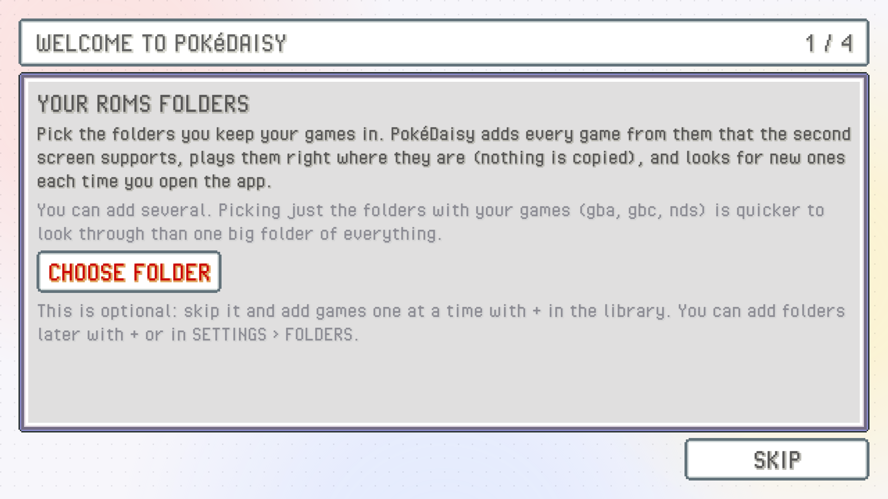
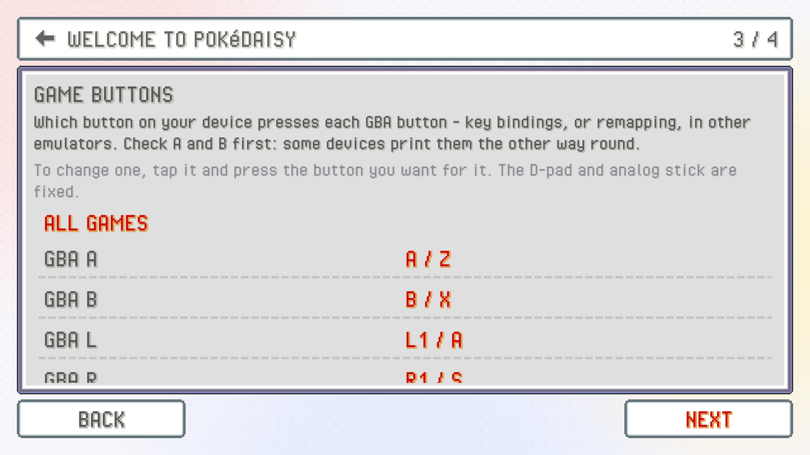
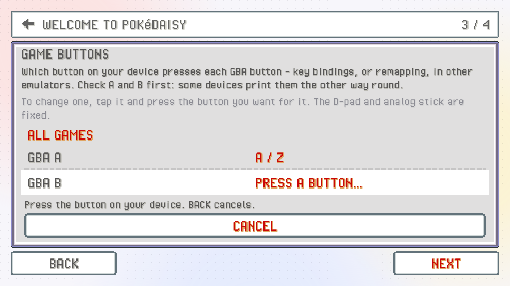

PokeDaisy isn't on the Play Store. You install it from its GitHub page as an APK file, and the app then keeps itself up to date. The whole thing takes a few minutes.

## Download and install the APK

1. On the device, open the [latest release](https://github.com/lidor30/pokedaisy/releases/latest) in a browser.
2. Under **Assets**, tap `PokeDaisy-<version>.apk` to download it.
3. Open the downloaded file (from the browser's download notice, or your file manager's Downloads folder).
4. If Android says it isn't allowed to install apps from this source, tap through to its settings, allow it for your browser or file manager, and go back. Then tap **Install**.
5. Open PokeDaisy.

> [!NOTE]
> PokeDaisy comes with no games. You'll need your own ROMs, dumped from cartridges you own.

## First-time setup

The first time you open PokeDaisy with an empty library, it shows `WELCOME TO POKéDAISY`: five short steps, numbered `1 / 5` to `5 / 5` in the corner. Every step is optional. The button at the bottom right says `SKIP` until you've chosen something, then `NEXT`, and `DONE` on the last step. `BACK` goes to the previous step.

Everything you pick here can be changed later in Settings, so don't overthink it.

### Step 1: your ROMs folders

If you keep your games in folders (say `ROMs/gba` and `ROMs/nds`), point PokeDaisy at them here. Tap `CHOOSE FOLDER` and pick a folder, then `ADD FOLDER` for each other one. PokeDaisy looks through them (`LOOKING FOR GAMES…`), then lists what it found under `FOUND 3 GAMES` or similar. `REMOVE` beside a folder takes it off again.

Pick just the folders your games are in rather than one big folder of everything: there's less to look through, so it's quicker.

Games in these folders are played right where they are: nothing is copied. Every time you come back to the library, the folders are checked again for new games, so adding a game later is a matter of dropping it into one.

Skip this step if you'd rather add games one at a time with the `+` button in the library. [Your game library](library.md) explains both ways.

### Step 2: game saves

This decides where your save files go. Your choices:

- `KEEP THEM IN POKéDAISY` (the default): saves go in the app's own folder.
- **A folder that already has saves in it.** PokeDaisy lists any folder it finds with `.sav` or `.srm` files, with how many saves are in each: your ROMs folders (and a `saves` folder inside each), and RetroArch's save folders (such as `RetroArch/saves/mGBA` or `RetroArch/saves/gpSP`) on the device and an SD card.
- `CHOOSE ANOTHER FOLDER…` to pick any other folder.

If you already play these games in another emulator, pick its save folder and carry on with the same saves. A game finds its save by the ROM's file name, so `Pokemon Emerald.gba` uses `Pokemon Emerald.sav` (or `.srm`). [Saves, backups and save states](saves.md) has more on sharing saves.

### Step 3: game buttons

This page shows which of your device's buttons presses each GBA button. Check A and B first: some devices print them the other way round from what you'd expect. If anything's off, tap that GBA button's row and press the button you want for it, right there on the page. `CANCEL`, or `BACK`, leaves it as it was.

### Step 4: cover art

The library looks much better with box art. Covers come from two free services, and each needs a key you get from your own free account:

- **RetroAchievements** box art: tap `OPEN RetroAchievements`, copy your **Web API key** from the page that opens (it's on your RetroAchievements settings page) and paste it in the box beside the button.
- **SteamGridDB** icons, for games RetroAchievements has no art for: tap `OPEN SteamGridDB`, copy your API key and paste it in the box beside that button.

One key is enough. Tap `SAVE` and PokeDaisy fetches covers for your games (`FETCHING…`). Skip it now and add a key any time in Settings > `COVER ART`.

### Run setup again

Open Settings (the gear in the library's header) and tap `RUN SETUP` at the bottom, in the `APP` group. Setup opens over the library; `BACK` on the first step takes you back to Settings.

## All files access

When you pick a folder (a ROMs folder, a saves folder, a game's own save folder), Android 11 and newer first ask you to allow PokeDaisy **All files access**. The app needs it to open games and saves by their path, wherever they are on the device, so it can play games from your folder without copying them and write saves where another emulator will see them.

Android opens its own page for it: turn it on and come back. Setup picks up where you left off.

If you don't allow it, PokeDaisy still works: import games with `+` and keep saves in its own folder.

> [!NOTE]
> Only folders on the device's own storage and SD card work. Cloud folders from a file picker (Google Drive and the like) can't be linked.

## After setup

A couple of one-time windows may show up in the library over the next few opens:

- `NEW: EXPAND` offers to turn on EXPAND, which draws the map past the game's edges so the whole top screen is the game. `TURN ON` or `NOT NOW`; it's in Settings > `ASPECT` either way. See [Screen, aspect and shaders](screen.md).
- `CRASH REPORTS?` asks, once, whether the app may send a report when it crashes. It's off unless you say yes, and you can change it any time in Settings > `CRASH REPORTS`.

Then pick a game and play. [Your game library](library.md) is the next page.

## Updates

PokeDaisy checks for a new version each time you open the library. When there is one, it shows `UPDATE AVAILABLE` with what's new:

- `UPDATE` downloads the new APK and opens Android's installer. Tap **Update** there. If Android asks to allow installs from PokeDaisy, allow it and go back.
- `RELEASE PAGE` opens the release on GitHub.
- `LATER` puts it off until the next time you open the library.

Updating keeps everything: your library, saves, states and settings.

The first time you open the library after an update, `WHAT'S NEW` shows the main changes in that version, once. `RELEASE PAGE` opens the full notes on GitHub and `OK` closes it.

To check right now, open Settings and tap `VERSION` (in the `APP` group). It shows the version you have, and tapping it looks for a newer one.

> [!TIP]
> If an update keeps downloading but never installs, check that PokeDaisy is allowed to install apps (Android's settings, **Apps**, PokeDaisy, **Install unknown apps**). [Troubleshooting](troubleshooting.md) has more.
