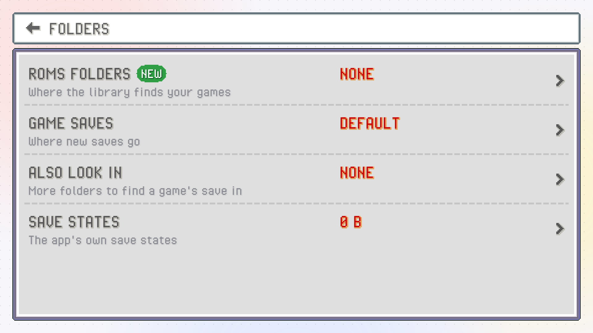

Your progress lives in two kinds of files. The **save file** is what the game writes when you save in the game's own menu: a standard `.sav` or `.srm`, the same as mGBA and RetroArch use, so you can carry it between emulators. **Save states** are snapshots of the whole moment, taken by PokeDaisy at any time, even mid-battle.

This page covers both, and how PokeDaisy keeps your save file safe.

## Your save file is protected

Losing a 40-hour save is the worst thing an emulator can do, so PokeDaisy is careful with it:

- **A backup every time you start a game.** Before the game opens its save, PokeDaisy copies it into a `pokedaisy-backups` folder next to the save. It keeps the newest 10 different copies for each game, and only makes a new one when the save has changed.
- **Resuming never overwrites a newer save.** When a game picks up where you left off, PokeDaisy first checks the save file hasn't changed since. If it has (you played it in RetroArch, copied in another save, or moved your saves folder), the old snapshot is set aside and the game starts from the save file instead.
- **A save in progress always finishes.** If you leave the game while it says it's saving (HOME, the recent apps screen, `CLOSE GAME`), PokeDaisy lets the save finish before it stops the game, so swiping PokeDaisy away right after can't leave a half written save behind.
- **Loading another save keeps the old one.** `LOAD SAVE` renames your current save to a dated copy before putting the new one in place.

## Where your saves live

A game finds its save by the ROM's file name: `Pokemon Emerald.gba` uses `Pokemon Emerald.sav` (or `.srm`). For a zipped game, it's the name of the ROM inside the archive, the same as RetroArch.

PokeDaisy looks for a game's save in this order, and uses the first place that has one:

1. **The game's own save folder**, if you gave it one (`SAVE FOLDER` in its library menu).
2. **The saves folder**: PokeDaisy's own, or the one you picked in setup or Settings.
3. **The `ALSO LOOK IN` folders**, in the order you added them.

If none of them has a save yet, the game's first save goes into the saves folder (or its own folder, if it has one). Only the folders themselves are looked in, never the folders inside them.

### Change the saves folder

Open Settings > `FOLDERS` > `GAME SAVES`. You'll see the current folder and the saves in it:

- `CHANGE FOLDER` picks another folder.
- `USE DEFAULT` goes back to PokeDaisy's own folder, `Android/data/com.pokedaisy.app/files/saves/`.
- `COPY PATH` copies the folder's path, handy for a file manager.

Changing the folder doesn't move any saves. Copy them over yourself if you want them in the new place.

### Share saves with RetroArch

To keep playing the same saves in RetroArch and PokeDaisy, add RetroArch's save folders in Settings > `FOLDERS` > `ALSO LOOK IN` with `ADD FOLDER`. RetroArch often keeps one folder per core, so add each one you use, for example `RetroArch/saves/mGBA` and `RetroArch/saves/gpSP`.

A save found in one of those folders is played and written right there, so RetroArch keeps seeing your latest progress. `REMOVE` takes a folder off the list.

> [!WARNING]
> If a game has a save in the saves folder *and* in an `ALSO LOOK IN` folder, the saves folder's copy wins. Keep one copy of each save to avoid surprises.

If you sync your saves between devices (with Syncthing, say), it's fine to point PokeDaisy at the synced folder. Since only the folder itself is looked in, old copies kept in a folder inside it (like Syncthing's `.stversions`) are left alone.

### Give one game its own folder

Sometimes only one game should use another folder, such as a hack you play in another emulator. Long-press it in the library, tap `SAVE FOLDER` and pick the folder.

If that folder has no save for the game yet, your current save is copied there (copied, not moved: the old file stays where it was). From then on, the game reads and writes its save in that folder. `DEFAULT SAVE FOLDER` in the same menu sends it back to the usual folders.

## Backups and RESTORE BACKUP

Backups go into a `pokedaisy-backups` folder beside the save, named after the game with the date and time, like `Pokemon Emerald.backup-20261007-233512.sav`. Since they sit next to your saves (not hidden in the app), a file manager reaches them, and they stay even if you uninstall PokeDaisy.

To bring one back, long-press the game in the library and tap `RESTORE BACKUP`. Pick a backup by its date and time, then confirm with `LOAD`. Your current save is kept as a dated copy first, so restoring is never a one-way trip.

> [!TIP]
> Cheats can break a save. Since a backup is taken every time a game starts, you can always go back to how the save was before you turned one on.

## Load a save file

To use a save from somewhere else (an old save from another emulator, a friend's file), long-press the game in the library and tap `LOAD SAVE`. Pick the file, and PokeDaisy tells you what it's about to do before you confirm with `LOAD`:

- Your current save is renamed to `<game>.backup-<date and time>` next to it, so nothing is lost.
- The new file is written under the name the game reads.
- The next time you start the game, it starts from this save rather than picking up where you left off.

If the file doesn't look like a GBA save, the confirmation says so.

## Resuming where you left off

With `RESUME GAMES` on (the default, in Settings > `LIBRARY`), closing a game saves a snapshot of the exact moment, and starting it again drops you right back there, mid-route or mid-battle. You don't even need to have saved in the game.

Turn it off if you'd rather every launch start at the title screen and load your in-game save, like a real cartridge. Coming back to a game you left open (after pressing HOME, say) still carries on where you were.

Putting your device to sleep mid-game is safe too. The game holds still on the exact frame and carries on from it the moment you wake the device, with nothing to reload. If Android closes the app while the device sleeps, that counts as closing the game: with `RESUME GAMES` on, you pick up from the moment it went to sleep.

> [!WARNING]
> With `RESUME GAMES` off, closing a game loses anything since your last in-game save. `CLOSE GAME` and `RESTART GAME` in the companion's `SETTINGS` remind you.

## Save states

Save states are instant snapshots you can take and load at any moment: before a tough battle, before trying to catch something rare, before a choice you might regret.

### The STATES tab

The companion's `STATES` tab shows 10 slots (`SLOT 0` to `SLOT 9`), each with a screenshot of the moment and when it was saved. It isn't in the tab bar at first: find it under `MORE`, left of the gear, or put it in the tab bar with `TAB BAR`.

- `SAVE` under a slot saves the game into it, replacing what was there.
- `LOAD` puts the game back to that moment.
- `UNDO SAVE` gives the last slot you saved over its previous contents back.
- `UNDO LOAD` takes you back to right before the last load.

The title shows the current slot, the one the hotkeys save to and load from.

> [!NOTE]
> A save state holds the game's save file as it was at that moment, too. Loading an old state brings that older in-game save back with it. If that wasn't what you wanted, `UNDO LOAD` returns you to where you were, and your save was backed up when the game started.

### Hotkeys for states

You can save and load without opening the tab:

| Hotkey | Default |
| --- | --- |
| `SAVE STATE` | SELECT + R1 (F1 on a keyboard) |
| `LOAD STATE` | SELECT + L1 (F2) |
| `UNDO SAVE` | F3 |
| `UNDO LOAD` | F4 |
| `SLOT NEXT` | ] on a keyboard |
| `SLOT PREV` | L3 ([ on a keyboard) |

Change them under `HOTKEYS` in Settings. See [Controls](controls.md).

Save states are kept per game in `Android/data/com.pokedaisy.app/files/states/`, listed in Settings > `FOLDERS` > `SAVE STATES`. The library's `INFO` for a game shows how many slots it uses.

## Rewind

Walked into the wrong trainer, or picked the wrong move? With rewind on, you can hold a button and play the last 20 seconds or so backwards, then carry on from any point.

1. Turn on `REWIND` in Settings (top screen or companion, in the `FF / SPEED` group). It's off by default, since it uses some memory and a little battery while on.
2. Hold the `REWIND HOLD` hotkey to go back. Let go to play on from there.

On a keyboard, `REWIND HOLD` is R. It has no controller button until you pick one under `HOTKEYS` (see [Controls](controls.md)). The sound is muted while you rewind, and when you reach the oldest moment it keeps, the picture stops there.

Rewinding never touches your save file: it only moves the game back in time, and whatever you saved in the game stays saved until the game saves again.
